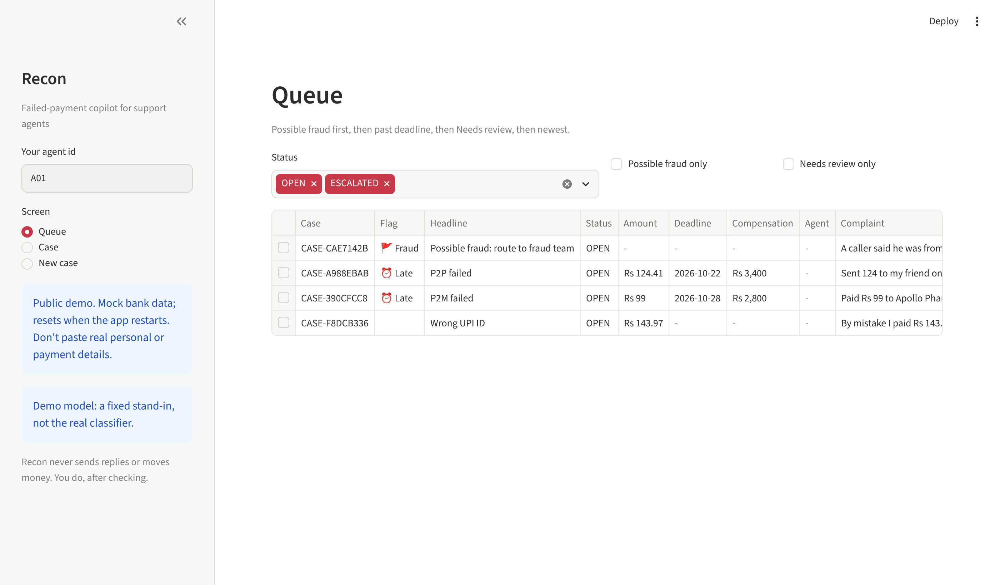
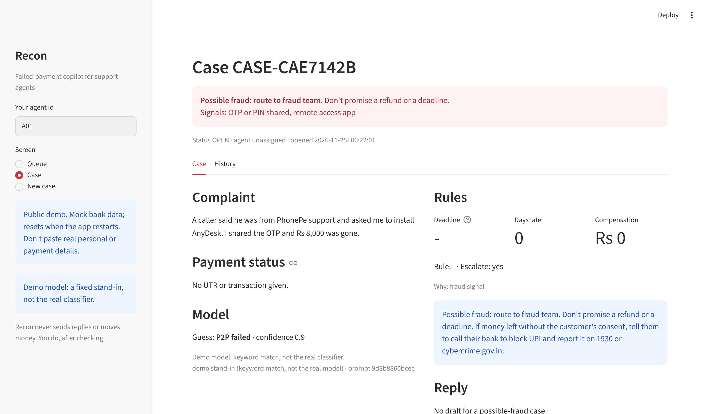
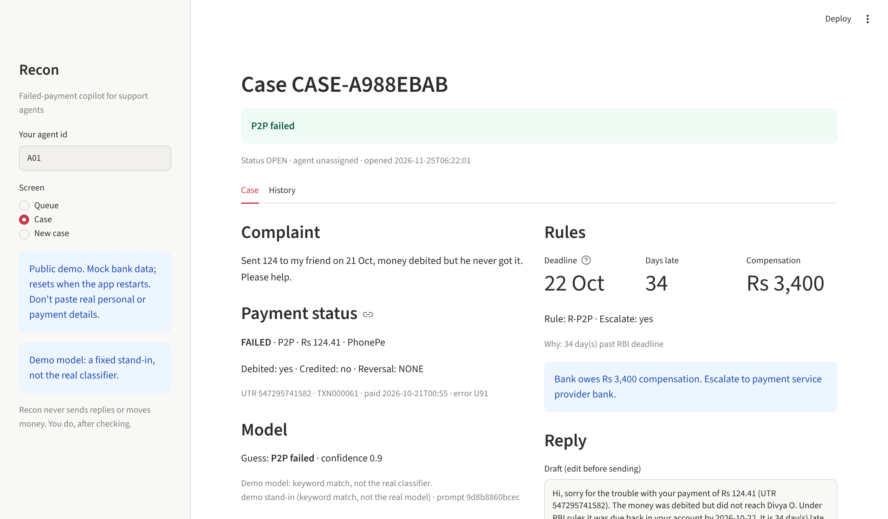

# Recon

An AI copilot for support agents at UPI apps (PhonePe, Google Pay, Paytm) that handles failed-payment complaints. It reads the complaint, checks the payment status, applies RBI's refund deadlines and compensation rules, flags possible fraud, and drafts a reply. The agent approves every action. Recon never moves money and never messages a customer on its own.

**[Live demo](https://recon-upi.streamlit.app)** · **[PRD](https://claude.ai/artifact/G8X7k6kSoBh3WZxE6T7kJm)** · Independent portfolio project by Nivedh Mohanan

> The demo runs on mock bank data and resets when the app restarts. If it has been idle, it takes about a minute to wake up.



## The problem

When a UPI payment fails but the money has left the customer's account, RBI rules say it must come back by **T+1** for person-to-person payments and **T+5** for merchant payments. After that the bank owes **Rs 100 a day**. To handle one complaint, an agent has to read a vague message, find the transaction, count the deadline by hand, work out the compensation, decide whether to escalate to the payment service provider bank, and write a reply. Most of these complaints land at three apps, which carry 85.9% of UPI volume (NPCI, Sep 2026).

## What it does

| Part | What it does | Model or code |
| --- | --- | --- |
| Classifier | Sorts a complaint into P2P failed, P2M failed, Wrong UPI ID, Out of scope or Needs review | Model (gpt-oss-120b on Groq), with code overrides |
| Rules engine | RBI deadline, days late, compensation, when to escalate | Code |
| Possible-fraud flag | OTP shared, remote-access apps, QR "scan to receive", fake army buyers, task scams and more. Holds the refund path until an agent decides | Model and 9 code signals |
| Failure handling | One retry on a failed status check, then Needs review with the reason shown. Same for model errors, broken output and confidence under 0.8 | Code |
| Audit log | Full snapshot of each case at open (model, prompt version, rule, draft) plus every later step. The database refuses edits and deletes | Code |
| Agent screens | Queue ordered by risk, case view with evidence and actions, case history | Streamlit |
| API | Status lookup, classify, draft reply, escalation (needs an agent id and an idempotency key), case events | FastAPI ([spec](docs/api.md)) |

| Possible fraud | Late P2P failure |
| --- | --- |
|  |  |

## Results

**Classifier, on real complaints.** 200 complaints collected and labelled by hand from r/UPI, Play Store 1-star reviews and consumercomplaints.in.

| Run | Complaints | Accuracy | Notes |
| --- | --- | --- | --- |
| Dev (prompt tuned on these) | 61 | 84% | |
| Holdout 1 (never tuned on) | 106 | 78% | 100% recall on P2P and P2M failures. 15 harmful mislabels, 10 of them at 0.8+ confidence |
| Holdout 2 (fresh, after fixes) | 33 | 85% | 20 fraud complaints: 18 flagged, 1 false alarm in 13 |

Neither holdout reached the 90% pass mark. The failures, and what changed because of them, are in the PRD under "Known failures".

**Timed baseline.** One tester (the builder), 6 cases by hand and 6 matched cases with Recon:

| | By hand | With Recon |
| --- | --- | --- |
| Median time per case | 95 s | 25 s |
| Deadline correct | 33% | 100% |
| Dispute type correct | 67% | 100% |

This is a small self-test that shows direction, not a production number. The test cases are easier than real complaints.

## Run it locally

```bash
pip install -r requirements.txt
streamlit run recon/ui.py          # agent screens at http://localhost:8501
python -m pytest                   # 89 tests
```

The classifier needs a free [Groq API key](https://console.groq.com/keys): `export GROQ_API_KEY=...`.
Without one, `RECON_DEMO_MODEL=1 streamlit run recon/ui.py` uses a keyword stand-in, labelled as such on every screen and in every case record.

Other entry points:

```bash
uvicorn recon.api:app --reload             # API docs at /docs, ops dashboard at /dashboard
python -m recon.evaluate --split holdout   # score the classifier (needs the Groq key)
python -m recon.baseline report            # manual vs Recon timing results
```

## Mock data

Transactions are simulated. Their shape comes from public NPCI data:

| What | Source |
| --- | --- |
| App mix among the top 3 (PhonePe 53%, Google Pay 38%, Paytm 9%) | NPCI UPI Applications, Sep 2026 |
| Payer banks and reversal success rates | NPCI Top 50 Remitter Banks, Aug 2026 |
| Error codes and meanings | NPCI UPI Error and Response Codes v2.9 |

About 30% of the mock transactions are problem cases, against under 1% in real UPI, so that every path in Recon gets exercised.

## Layout

```
recon/classifier.py      complaint -> dispute type, fraud signals, code overrides (model)
recon/rules_engine.py    RBI deadline, compensation, escalation (no model)
recon/case_flow.py       opens a case end to end, applies the failure rules
recon/case_store.py      case record and append-only audit log
recon/api.py, api_v1.py  FastAPI endpoints (spec: docs/api.md)
recon/ui.py              agent screens (Streamlit)
recon/evaluate.py        classifier evaluation on the real complaints
recon/baseline.py        timed manual-vs-Recon test
recon/seed.py            500 mock transactions
data/complaints_test_set.csv   the 200 labelled complaints
tests/                   unit, API, failure, audit, fraud and end-to-end tests
```

## Limits

- Status lookup and escalation run against mock systems, not real banks or NPCI.
- Replies come from fixed English templates; the model doesn't write them yet.
- The prototype sends complaint text to Groq. A real deployment would need an India-hosted model or masked text (RBI's 2018 rule on storing payment data in India).
- The ops dashboard runs on simulated cases.
