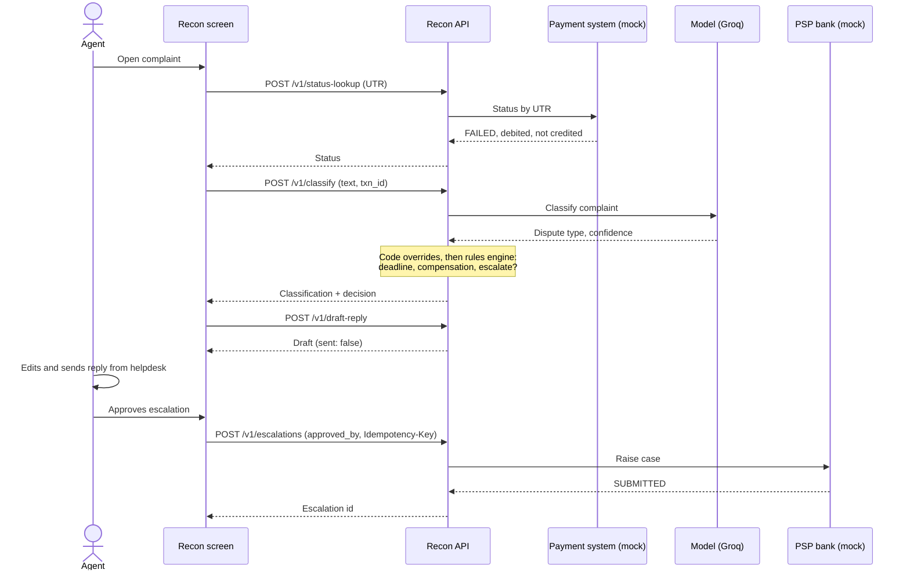

# Recon API v1

Code: `recon/api_v1.py`. Tests: `tests/test_api_v1.py`. Run `uvicorn recon.api:app --reload`, docs at `/docs`.

Status lookup and escalation talk to **mocks**. There is no real bank or NPCI connection.
Recon has no "send reply" endpoint: the agent sends from their own helpdesk tool.

| Endpoint | Purpose | Called when | Timeout (assumption) |
| --- | --- | --- | --- |
| `POST /v1/status-lookup` | Payment status from the payment system (mock) | Case opens | 3 s |
| `POST /v1/classify` | Model labels the complaint; code applies RBI rules | After status lookup | 20 s per model call |
| `POST /v1/draft-reply` | Template reply for the agent to edit | After classify | 2 s |
| `POST /v1/escalations` | Raise a case with the payment service provider bank (mock) | Agent approves | 5 s |
| `POST /v1/cases` | Whole flow in one call, with the failure rules (below). Stores the case | Case opens | sum of the above |
| `GET /v1/cases/{id}` | Case record at open + full history | Any time | - |
| `POST /v1/cases/{id}/events` | Agent step: `opened`, `dispute_type_changed` (needs `note`), `reply_sent` (`value` = text sent), `closed` | Each agent step | - |
| `GET /cases/{id}` | Case history page (HTML) | Any time | - |

## Failure rules

- Status lookup: a timeout or error is retried once (0.5 s wait, assumption). "Not found" is not retried.
- After two failed status checks, or a model timeout, model error, broken model answer or confidence under 0.8,
  `/v1/cases` returns `"dispute_type": "Needs review"` with `needs_review_reasons` and `model_guess`.
- Full edge-case table: PRD, "Failure handling".

## Sequence



## Examples

Real responses from the mock data (transaction TXN000061).

`POST /v1/status-lookup`
```json
{"utr": "547295741582"}
```
```json
{"txn_id": "TXN000061", "utr": "547295741582", "txn_type": "P2P", "amount_inr": 124.41,
 "status": "FAILED", "debited": true, "credited": false, "error_code": "U91",
 "error_meaning": "BENEFICIARY BANK DEEMED HIGH RESPONSE TIME CHECK DECLINE",
 "reversal_status": "NONE", "reversed_at": null, "funding_source": "UPI",
 "created_at": "2026-10-21T00:55", "checked_at": "2026-11-19T06:44:50", "source": "mock payment system"}
```

`POST /v1/classify`
```json
{"complaint_text": "Sent money to my brother, debited but he didn't get it", "txn_id": "TXN000061"}
```
```json
{"classification": {"dispute_type": "P2P failed", "confidence": 0.95, "amount_inr": 124.41,
   "fraud_signal": false, "out_of_scope_reason": null, "reason": "Paid a person, debited, not received.",
   "overrides": []},
 "decision": {"rule_id": "R-P2P", "refund_state": "due", "deadline_date": "2026-10-22",
   "days_past_deadline": 28, "compensation_inr": 2800, "escalate": true,
   "escalation_reasons": ["28 day(s) past RBI deadline"], "route_to": null},
 "txn_id": "TXN000061", "fallback": false}
```

`POST /v1/draft-reply`
```json
{"dispute_type": "P2P failed", "refund_state": "due", "txn_id": "TXN000061",
 "deadline_date": "2026-10-22", "days_past_deadline": 28, "compensation_inr": 2800}
```
```json
{"template_id": "refund_due", "language": "en", "sent": false,
 "draft": "Hi, sorry for the trouble with your payment of Rs 124.41 (UTR 547295741582). The money was debited but did not reach Divya O. Under RBI rules it was due back in your account by 2026-10-22. It is 28 day(s) late, so you are owed Rs 2,800 compensation by your bank. We are following up with the bank and will update you."}
```

`POST /v1/escalations` with header `Idempotency-Key: 3f2a9c1e`
```json
{"txn_id": "TXN000061", "reasons": ["28 day(s) past RBI deadline"], "approved_by": "A07"}
```
```json
{"escalation_id": "ESC-EBFB65A4", "txn_id": "TXN000061", "reasons": ["28 day(s) past RBI deadline"],
 "approved_by": "A07", "psp_bank": "Mock PSP bank (PhonePe)", "status": "SUBMITTED",
 "submitted_at": "2026-11-19T06:44:50", "mock": true}
```
Same key again returns the same escalation (200). A new key for the same transaction returns 409.

## Errors

Body: `{"error": {"code": "TXN_NOT_FOUND", "message": "No transaction for txn_id TXN999999"}}`

| HTTP | Code | When |
| --- | --- | --- |
| 400 | INVALID_INPUT | Missing or bad field |
| 400 | MISSING_REFERENCE | Status lookup without txn_id or UTR |
| 400 | MISSING_IDEMPOTENCY_KEY | Escalation without the header |
| 404 | TXN_NOT_FOUND | No transaction for that id or UTR |
| 409 | ALREADY_ESCALATED | Transaction already has an open escalation |
| 409 | DRAFT_NOT_ALLOWED | Possible fraud: no reply is drafted |
| 400 | NOTE_REQUIRED | Dispute type changed without a note |
| 404 | CASE_NOT_FOUND | No case with that id |
| 409 | CASE_CLOSED | Step sent to a closed case |
| 413 | COMPLAINT_TOO_LONG | Complaint over 4,000 characters (assumption) |
| 502 | STATUS_ERROR, PSP_ERROR | Mock system returned an error |
| 504 | STATUS_TIMEOUT, PSP_TIMEOUT | Mock system did not answer in time |

`/v1/classify` never returns a 5xx when the model fails. It returns `Needs review` with `"fallback": true`.

Testing hook: header `X-Mock-Fail` makes the mocks fail. `timeout` / `error`: every attempt fails.
`timeout-once` / `error-once`: the first status check fails and the retry works.

## Audit log

Every case stores a snapshot at open (`cases.case_record`): complaint, status lookup, model name and prompt
version, model output, Needs review reasons, rules decision, draft. Every step after that is one row in
`audit_log` (actor = `recon` or the agent id). Database triggers refuse UPDATE and DELETE on `audit_log`;
only simulated demo rows (`CASE-SIM...`) can be cleared. Pass `case_id` on an escalation to log it on the case.
